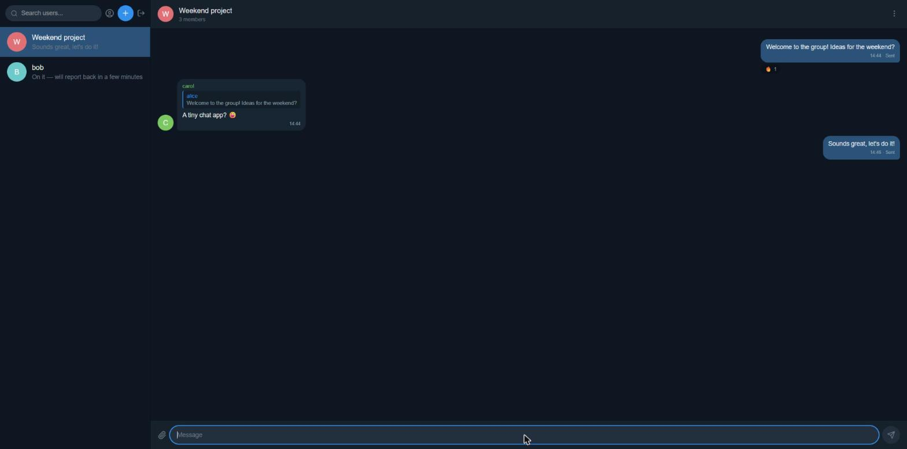
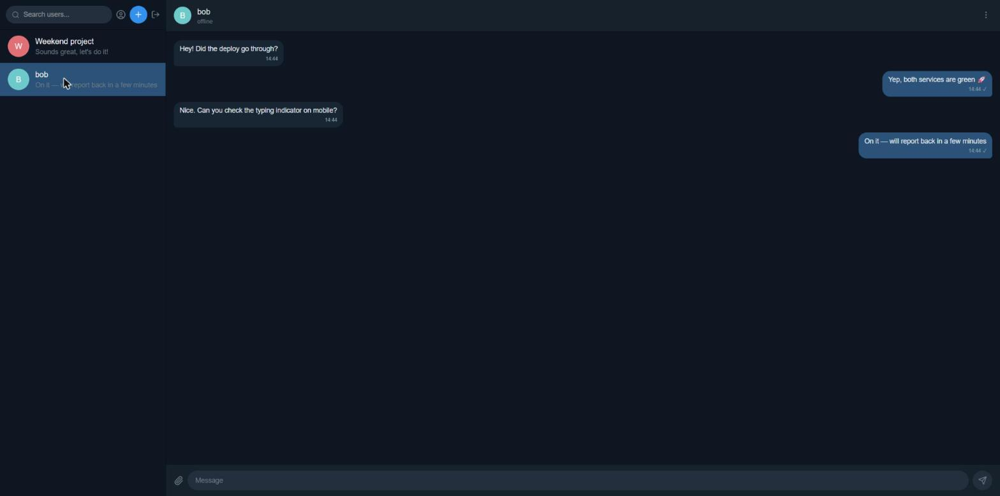
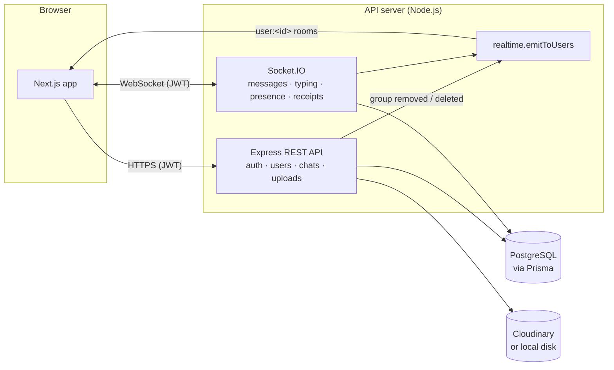

# MyMessenger

A real-time messenger with direct and group chats, built with **Next.js**, **Express**, **Socket.IO**, **Prisma** and **PostgreSQL**.

[](https://github.com/r671h/MyMessanger/actions/workflows/ci.yml)


**Live demo:** https://my-messanger-xi.vercel.app

| Group chat | Direct chat |
| --- | --- |
|  |  |

## Features

- **Direct and group chats** with real-time delivery over WebSockets.
- **Replies, reactions, editing and deletion.** Deleted messages stay in the thread as "message deleted".
- **Read receipts:** ✓ / ✓✓ in direct chats, "Seen by N" in groups.
- **Typing indicators and online presence.** Presence works across multiple tabs and devices.
- **File sharing** for images, video and documents (up to 24 MB). Files go to Cloudinary, or to local disk when Cloudinary isn't configured.
- **Group management:** create a group with an avatar, remove members, leave, delete. Affected users get notified instantly.
- **Profiles** with avatar and bio, plus case-insensitive user search.
- Responsive layout: two panes on desktop, a stacked chat list and chat view on mobile.

## Tech stack

| Layer | Technologies |
| --- | --- |
| Frontend | Next.js 16 (App Router), React 19, TypeScript, Tailwind CSS 4, socket.io-client |
| Backend | Node.js, Express 5, Socket.IO 4, TypeScript |
| Database | PostgreSQL, Prisma ORM (versioned migrations) |
| Auth | JWT in an httpOnly cookie plus a Bearer token, bcrypt password hashing |
| Storage | Cloudinary, with a local-disk fallback |
| Infra | Docker (multi-stage, non-root), Docker Compose, GitHub Actions, AWS ECS Fargate + RDS (CloudFormation) |
| Testing | `node:test` unit and HTTP tests, ESLint, strict type checking |

## Architecture



**How the real-time layer works:**

- Every socket joins a personal `user:<id>` room. The server delivers events to the members of a chat, never to everyone, so one user can have several tabs open.
- The client never decides who receives an event. On every send, edit, react, read or typing event, the server checks that the sender is a member of the chat.
- Direct and group messages live in separate tables but follow the same flows. A small adapter layer (`server/socket/chatAdapters.ts`) lets one set of handlers serve both.

## Security notes

Things I deliberately check and test (see `server/test` and the E2E checklist below):

- CORS accepts an **exact allow-list** of origins, not wildcard subdomains.
- Login returns the **same error** for an unknown email and a wrong password, so accounts can't be enumerated.
- A reply can only quote a message **from the same chat**. Otherwise a crafted `replyToId` could leak messages from someone else's chat.
- Attachment URLs must use `http(s)`, which blocks `javascript:` links.
- Reactions, read status and typing events require chat membership. "Removed from group" and "group deleted" notifications come only from the server.
- Inputs are validated, and every request is limited in size: JSON bodies, messages, uploads and file types. Errors come back as JSON with the correct status codes (400, 401, 403, 404, 409).
- The Docker image runs as a non-root user. Secrets come only from the environment.

## Getting started

### Option 1: Docker (recommended)

Requires Docker. No Cloudinary account is needed: uploads are stored in a Docker volume.

```bash
cp .env.example .env          # then set JWT_SECRET to a long random string
docker compose up --build
docker compose exec server npm run db:seed   # optional: demo users and chats
```

Open http://localhost:3000. The API runs on http://localhost:4000.

After seeding, you can log in as `alice@demo.local`, `bob@demo.local` or `carol@demo.local` with password `demo1234`. Open two browsers to chat between users.

### Option 2: Local Node.js

Requires Node.js 20+ and a running PostgreSQL.

```bash
# API
cd server
cp ../.env.example .env       # set JWT_SECRET and DATABASE_URL
npm install
npx prisma migrate dev        # creates the schema
npm run db:seed               # optional demo data
npm run dev                   # http://localhost:4000

# Web client (in another terminal)
cd client
npm install
npm run dev                   # http://localhost:3000
```

### Environment variables

| Variable | Where | Description |
| --- | --- | --- |
| `JWT_SECRET` | server | **Required.** Secret used to sign JWTs |
| `DATABASE_URL` | server | PostgreSQL connection string |
| `FRONTEND_URL` | server | Comma-separated list of allowed frontend origins (CORS) |
| `PUBLIC_API_URL` | server | Public API URL, used for links to locally stored files |
| `CLOUDINARY_*` | server | Optional. Enables Cloudinary storage |
| `NEXT_PUBLIC_API_URL` | client (build time) | API URL used by the browser |

## Testing

```bash
cd server && npm test          # unit and HTTP tests (no database needed)
cd server && npm run typecheck
cd client && npm run lint && npm run build
```

CI (`.github/workflows/ci.yml`) runs all of these, plus both Docker image builds, on every push and pull request.

## Project structure

```
├── client/                     Next.js frontend
│   ├── app/                    routes: login, register, messages (dm / group / new-group), profile, users
│   └── src/
│       ├── components/         MessageBubble, ChatInput, ReactionBar, skeletons, ...
│       ├── lib/                API client, socket factory, helpers
│       └── types/
├── server/                     Express + Socket.IO API
│   ├── routes/                 REST endpoints (auth, users, conversations, groupchats, upload)
│   ├── socket/                 real-time handlers + DM/group adapters
│   ├── lib/                    validation, CORS, storage, realtime emitter
│   ├── middleware/             auth guard, JSON error handler
│   ├── prisma/                 schema, migrations, seed
│   └── test/
├── infra/aws/                  CloudFormation templates for ECS Fargate + RDS + ALB
├── .github/workflows/          CI, AWS deploy (OIDC), AI code review
└── docker-compose.yml          full local stack (Postgres + API + client)
```

## API overview

<details>
<summary>REST endpoints</summary>

| Method | Path | Description |
| --- | --- | --- |
| POST | `/api/auth/register` | Create an account |
| POST | `/api/auth/login` | Log in (sets cookie, returns token) |
| POST | `/api/auth/logout` | Clear the session cookie |
| GET | `/api/auth/me` | Current user |
| GET | `/api/users/search/:query` | Search users by username |
| GET | `/api/users/:id` | Public profile |
| PATCH | `/api/users/me` | Update bio |
| POST | `/api/users/me/avatar` | Upload avatar |
| GET / POST | `/api/conversations` | List / start direct chats |
| GET | `/api/conversations/:id` | Chat header info + read status |
| GET | `/api/conversations/:id/messages` | Message history |
| POST | `/api/conversations/:id/hide` | Remove a chat from my list |
| GET / POST | `/api/groupchats` | List / create groups |
| GET / DELETE | `/api/groupchats/:id` | Group details / delete (creator) |
| GET | `/api/groupchats/:id/messages` | Message history |
| GET | `/api/groupchats/:id/read-status` | Per-member read timestamps |
| POST | `/api/groupchats/:id/leave` | Leave a group |
| DELETE | `/api/groupchats/:id/members/:userId` | Remove a member (creator) |
| POST | `/api/upload` | Upload a chat attachment |
| GET | `/api/health` | Health check |

</details>

<details>
<summary>Socket.IO events</summary>

| Client → server | Server → clients |
| --- | --- |
| `dm:send` / `groupchat:send` | `dm:new` / `groupchat:new` |
| `dm:edit`, `dm:delete` (and group equivalents) | `dm:updated` / `groupchat:updated` |
| `dm:react` / `groupchat:react` | `dm:reactions-updated` / `groupchat:reactions-updated` |
| `conversation:read` / `groupchat:read` | `conversation:read-update` / `groupchat:read-update` |
| `typing:start`, `typing:stop` `{ chatType, chatId }` | `typing:update` |
| — | `presence:list`, `presence:update` |
| — | `groupchat:removed`, `groupchat:deleted` |

</details>

## Deployment

- **Frontend:** Vercel (`client/`, with `NEXT_PUBLIC_API_URL` pointing to the API).
- **API:** any Docker host. Set `FRONTEND_URL` to the frontend origin. On startup the container runs `prisma migrate deploy` before the server starts.
- **AWS:** a full production setup is in [`infra/aws/README.md`](infra/aws/README.md). It covers ECS Fargate behind an HTTPS ALB, private encrypted RDS, Secrets Manager, and GitHub Actions deploys through OIDC (no long-lived AWS keys).

## Limitations and roadmap

- Presence and Socket.IO rooms live in memory, so the API runs as **one instance**. Scaling out requires the Redis adapter and shared presence.
- Message history loads in one request. Cursor pagination with infinite scroll is next.
- Planned: push notifications, message search, end-to-end tests in a browser (Playwright).

## License

[MIT](LICENSE)
